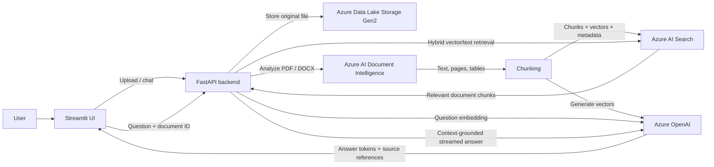

# Document Intelligence Chat

> Upload a PDF or DOCX, extract its contents with Azure Document Intelligence,
> and ask questions answered from the document with citations.

This project is a document question-answering application built around a
retrieval-augmented generation (RAG) pipeline. It combines a Streamlit chat
interface, a FastAPI backend, Azure Document Intelligence, Azure OpenAI, Azure
AI Search, and Azure Data Lake Storage Gen2.

<p align="center">
  <a href="#quickstart">Quickstart</a> ·
  <a href="#how-it-works">How it works</a> ·
  <a href="#configuration">Configuration</a> ·
  <a href="#use-the-api">API reference</a> ·
  <a href="#troubleshooting">Troubleshooting</a>
</p>

<details>
  <summary><strong>Table of contents</strong></summary>

- [Highlights](#highlights)
- [Technology stack](#technology-stack)
- [How it works](#how-it-works)
- [Architecture](#architecture)
- [Requirements](#requirements)
- [Quickstart](#quickstart)
- [Configuration](#configuration)
- [Run the application](#run-the-application)
- [Use the API](#use-the-api)
- [Azure AI Search index](#azure-ai-search-index)
- [Tests and code quality](#tests-and-code-quality)
- [Project structure](#project-structure)
- [Limitations and next steps](#limitations-and-next-steps)
- [Troubleshooting](#troubleshooting)
- [Security notes](#security-notes)

</details>

## Highlights

- Upload **PDF** and **DOCX** documents through a chat-oriented UI.
- Store original uploads in **Azure Data Lake Storage Gen2**.
- Extract document text and layout with **Azure AI Document Intelligence**
  (`prebuilt-layout`), including scanned PDFs and table content.
- Chunk extracted text, generate embeddings with an **Azure OpenAI embedding
  deployment**, and store chunks and vectors in **Azure AI Search**.
- Retrieve relevant chunks for a question and filter the search to the selected
  document.
- Stream answers from an **Azure OpenAI chat deployment** and show source file,
  page, and paragraph information where available.
- Keep chat messages in the current Streamlit session.

## Technology stack

| Layer | Technologies |
|---|---|
| User interface | Python, Streamlit |
| API | Python, FastAPI, Pydantic, Uvicorn |
| Document storage | Azure Data Lake Storage Gen2, Azure Identity |
| Text and layout extraction | Azure AI Document Intelligence |
| Embeddings and answer generation | Azure OpenAI, OpenAI Python SDK |
| Retrieval and vector index | Azure AI Search |
| Document processing | `python-docx`, `pypdf` |
| HTTP and configuration | HTTPX, `python-dotenv` |
| Quality checks | Pytest, Ruff |

## How it works

### Upload and indexing

1. Select a PDF or DOCX in Streamlit (maximum upload size: **10 MB**).
2. The frontend sends the file to `POST /documents/upload`.
3. The backend writes the original file to the configured ADLS filesystem under
   `documents/` with a generated storage filename.
4. Azure Document Intelligence analyzes the uploaded bytes using
   `prebuilt-layout`. The backend keeps page text for PDFs and document text and
   table rows for DOCX files.
5. The backend splits extracted text into overlapping chunks and requests a
   vector for each chunk from the Azure OpenAI embedding deployment.
6. Chunks, vectors, the generated `document_id`, and source metadata are
   uploaded to the `assignment-chunks` Azure AI Search index.
7. The API returns the `document_id`; the frontend retains it for follow-up
   questions in that session.

### Ask a question

1. Submit a question from the chat UI. The frontend calls `POST /chat`.
2. Azure OpenAI embeds the question.
3. Azure AI Search performs a hybrid text and vector search, filtered to the
   selected `document_id`.
4. The retrieved chunks and question are sent to the configured Azure OpenAI
   chat deployment with instructions to answer from the document context.
5. The answer streams to the UI. Source locations are sent as a separate event
   and displayed with the answer.

> **Storage trigger:** Processing starts when the application receives
> `POST /documents/upload`. Uploading a file directly to the Azure storage
> account does **not** trigger extraction or indexing. To process direct
> storage uploads, add an Azure Event Grid event subscription and a consumer
> such as an Azure Function.

## Architecture



## Requirements

- Python **3.9 or newer**.
- An Azure subscription with:
  - Azure Data Lake Storage Gen2 and a filesystem/container.
  - Azure AI Document Intelligence.
  - Azure AI Search.
  - Azure OpenAI deployments for embeddings and chat.
- For local development, Azure CLI authentication for ADLS:
  ```bash
  az login
  ```
- Network access from the machine running the app to the Azure endpoints.

The current search index schema expects **1,536-dimensional** vectors. Configure
an embedding deployment that produces vectors of this size (for example, an
`text-embedding-3-small` deployment using its default dimensions).

## Quickstart

Run these commands from the repository directory (`GEN_AI_Doc_Processing`).

### 1. Create a virtual environment

```bash
python3 -m venv .venv
source .venv/bin/activate
python -m pip install --upgrade pip
```

On Windows PowerShell, activate it with:

```powershell
.\.venv\Scripts\Activate.ps1
```

### 2. Install the application dependencies

```bash
pip install \
  fastapi \
  uvicorn \
  streamlit \
  httpx \
  python-multipart \
  python-dotenv \
  openai \
  azure-ai-documentintelligence \
  azure-search-documents \
  azure-identity \
  azure-storage-file-datalake \
  python-docx \
  pypdf
```

For development and tests:

```bash
pip install pytest ruff
```

### 3. Configure Azure

Create a `.env` file in the project root using the template below and fill in
your own Azure resource values. **Do not commit `.env` or paste secrets into
issues, screenshots, or source code.**

```dotenv
# Azure Data Lake Storage Gen2
AZURE_STORAGE_ACCOUNT_NAME=your_storage_account_name
AZURE_STORAGE_FILESYSTEM=your_filesystem_name

# Azure AI Document Intelligence
AZURE_DOCUMENT_INTELLIGENCE_ENDPOINT=https://your-resource.cognitiveservices.azure.com/
AZURE_DOCUMENT_INTELLIGENCE_KEY=your_document_intelligence_key

# Azure AI Search
AZURE_SEARCH_ENDPOINT=https://your-search-service.search.windows.net
AZURE_SEARCH_ADMIN_KEY=your_search_admin_key

# Azure OpenAI
AZURE_OPENAI_ENDPOINT=https://your-resource.openai.azure.com/openai/v1/
AZURE_OPENAI_API_KEY=your_azure_openai_key
AZURE_OPENAI_API_VERSION=2024-02-01
AZURE_OPENAI_EMBEDDING_DEPLOYMENT=your_embedding_deployment_name
AZURE_OPENAI_CHAT_DEPLOYMENT=your_chat_deployment_name

# Optional: backend URL used by the Streamlit frontend
BACKEND_API_URL=http://127.0.0.1:8000
```

For an Azure OpenAI endpoint ending in `/openai/v1`, the app uses the OpenAI
Python client with the v1 API; `AZURE_OPENAI_API_VERSION` is not used in that
mode. For a legacy Azure OpenAI endpoint without `/openai/v1`, set a supported
API version.

The storage integration uses `DefaultAzureCredential`. A local `az login` is
the usual development path; the authenticated identity needs permission to
create directories and upload files to the configured filesystem. In a hosted
deployment, use a managed identity with the equivalent data-plane permissions.

### 4. Create the AI Search index

Create or update the index once before uploading documents:

```bash
python scripts/create_search_index.py
```

This creates `assignment-chunks` with searchable chunk text, filterable
document/source metadata, and a vector field with 1,536 dimensions.

### 5. Start the backend and frontend

In terminal 1:

```bash
uvicorn backend.app.main:app --reload
```

In terminal 2:

```bash
streamlit run frontend/app.py
```

Open the local Streamlit URL printed in terminal 2. The API health check is
available at <http://127.0.0.1:8000/health>; interactive API documentation is
at <http://127.0.0.1:8000/docs>.

## Configuration

| Variable | Required | Purpose |
|---|:---:|---|
| `AZURE_STORAGE_ACCOUNT_NAME` | Yes | ADLS Gen2 account name |
| `AZURE_STORAGE_FILESYSTEM` | Yes | Filesystem/container where uploads are stored |
| `AZURE_DOCUMENT_INTELLIGENCE_ENDPOINT` | Yes | Document Intelligence resource endpoint |
| `AZURE_DOCUMENT_INTELLIGENCE_KEY` | Yes | Document Intelligence API key |
| `AZURE_SEARCH_ENDPOINT` | Yes | Azure AI Search service endpoint |
| `AZURE_SEARCH_ADMIN_KEY` | Yes | Search key used by the backend to create indexes, upload chunks, and search |
| `AZURE_OPENAI_ENDPOINT` | Yes | Azure OpenAI endpoint; `/openai/v1` is supported |
| `AZURE_OPENAI_API_KEY` | Yes | Azure OpenAI key |
| `AZURE_OPENAI_API_VERSION` | Legacy endpoint only | Azure OpenAI API version for non-v1 endpoints |
| `AZURE_OPENAI_EMBEDDING_DEPLOYMENT` | Yes | Embedding deployment name |
| `AZURE_OPENAI_CHAT_DEPLOYMENT` | Yes | Chat deployment name |
| `BACKEND_API_URL` | No | Frontend API base URL; defaults to `http://127.0.0.1:8000` |

Use the **deployment name**, not just the model family name, for both OpenAI
deployment variables.

## Run the application

1. Open the Streamlit UI and choose a `.pdf` or `.docx`.
2. Select **Upload and index document**. Wait for the upload/index success
   message; this request also performs Document Intelligence and embedding
   calls.
3. Ask a question in the chat input.
4. Review the streamed response and expand **View sources** to see available
   page or paragraph locations.
5. To switch documents, select a different file and upload it. The UI clears
   the previous document's chat state when the selected filename/size changes.

The backend returns a `document_id` for each successful upload. Search is
restricted to that ID, so chunks from other uploaded documents should not be
used to answer the question.

## Use the API

### Health check

```bash
curl http://127.0.0.1:8000/health
```

Expected response:

```json
{"status":"healthy"}
```

### Upload a document

```bash
curl -X POST http://127.0.0.1:8000/documents/upload \
  -F "file=@./path/to/your-document.pdf"
```

The successful response includes `document_id`, `filename`, `storage_path`,
`file_size`, and a status message. Keep the `document_id` for the chat request.

### Chat with the uploaded document

```bash
curl -N -X POST http://127.0.0.1:8000/chat \
  -H "Content-Type: application/json" \
  -d '{
    "question": "Summarize the main conclusions.",
    "document_id": "DOCUMENT_ID_FROM_UPLOAD"
  }'
```

Chat uses **Server-Sent Events (SSE)**. Events include `token` while the answer
streams, `sources` when source metadata is available, and `done` when the
response completes. A processing failure is returned as an `error` event.

## Azure AI Search index

The backend reads and writes to the index named `assignment-chunks`. Each
indexed record represents a chunk and includes:

- `chunk_id` — unique key for an indexed chunk.
- `document_id` — ID used to scope retrieval to an uploaded document.
- `file_name`, `file_type`, `page_number`, and `paragraph_number` — source
  metadata.
- `content` — extracted chunk text.
- `content_vector` — 1,536-dimensional embedding.

The Search service's index statistics and Search Explorer are the source of
truth for the number of indexed chunk records. The number of records is not the
same as the number of uploaded files.

## Tests and code quality

Run the unit tests:

```bash
python -m pytest tests/unit -v
```

Run Ruff:

```bash
ruff check backend frontend tests
```

Or run the project check script:

```bash
bash scripts/check.sh
```

Unit tests mock Azure calls; they do not require live Azure resources. To test
the actual integrations, configure Azure credentials and endpoints, create the
Search index, then upload a real document through the app.

## Project structure

```text
backend/app/
  api/routes/       FastAPI endpoints for uploads, chat, and document tools
  integrations/     Azure Storage, Document Intelligence, and Search clients
  rag/              Chunking, embeddings, vector retrieval, indexing, answers
  schemas/          Pydantic request and response models
  services/         Document and chat orchestration
  config.py         Project .env loading
  main.py           FastAPI application
frontend/
  app.py            Streamlit upload and chat interface
  api_client.py     HTTP and SSE client for the backend
scripts/
  create_search_index.py
tests/unit/
```

## Limitations and next steps

- Chat messages are displayed and retained by Streamlit for the current
  session, but previous turns are not sent to the model as conversation
  context.
- Uploads made directly to ADLS do not invoke processing; only
  `POST /documents/upload` runs the extraction and indexing pipeline.
- There is no document deletion endpoint or automatic Search-index cleanup yet.
- Scanned/image-only content depends on Document Intelligence returning
  extractable text.
- Azure services incur usage charges; review your resource pricing and quotas
  before running large uploads or high-volume tests.

## Troubleshooting

<details>
  <summary><strong>Azure OpenAI returns 404 / Resource not found</strong></summary>

Check that `AZURE_OPENAI_ENDPOINT` is the resource endpoint for the Azure
OpenAI resource, that the API key belongs to that resource, and that both
deployment variables exactly match deployment names in Azure AI Foundry. If
the endpoint ends in `/openai/v1`, the app uses the v1 client path. Restart the
backend after changing `.env`.

</details>

<details>
  <summary><strong>Chat returns Unsupported parameter: max_tokens</strong></summary>

The chat request uses `max_completion_tokens`, which is required by models such
as GPT-5.2. Restart the backend so it loads the updated code. Confirm the
configured chat deployment supports the OpenAI chat-completions API.

</details>

<details>
  <summary><strong>Upload succeeds but no answer is found</strong></summary>

Confirm the upload response says indexing completed and includes a
`document_id`. In Azure AI Search, check the `assignment-chunks` document count
and confirm that records exist for the returned document ID. Verify that the
embedding deployment returns 1,536 dimensions, matching the index vector field.

</details>

<details>
  <summary><strong>ADLS authentication or authorization error</strong></summary>

Run `az login` and confirm the correct subscription with `az account show`.
Grant the signed-in identity permission to upload data to the filesystem, and
check the account and filesystem names in `.env`.

</details>

<details>
  <summary><strong>Document Intelligence error</strong></summary>

Check the endpoint/key pair, resource availability, supported document format,
and network access. The current upload API accepts PDF and DOCX files up to
10 MB.

</details>

## Security notes

- Never commit `.env`, API keys, Search admin keys, or storage credentials.
- Use a managed identity and least-privilege access in deployed environments.
- The current backend uses the Azure AI Search admin key because it performs
  index writes; prefer a restricted credential strategy for production.
- Do not expose the FastAPI development server directly to the public internet.
- Uploaded documents and extracted content may contain sensitive information;
  apply appropriate access controls, retention policies, and privacy practices.